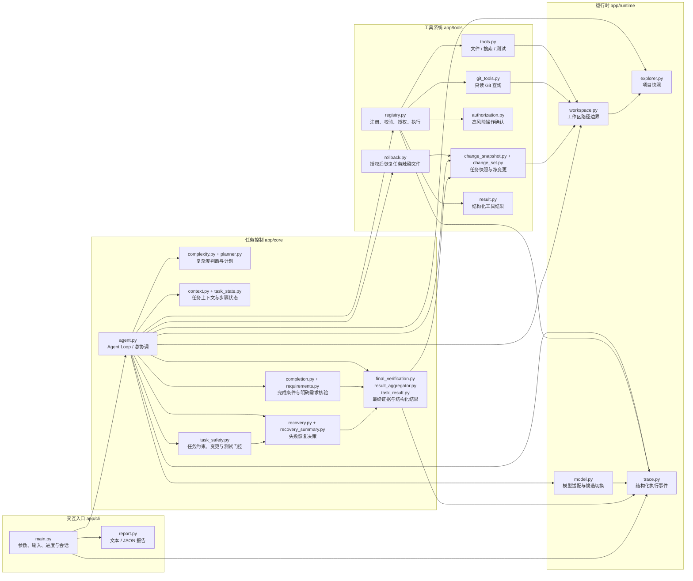
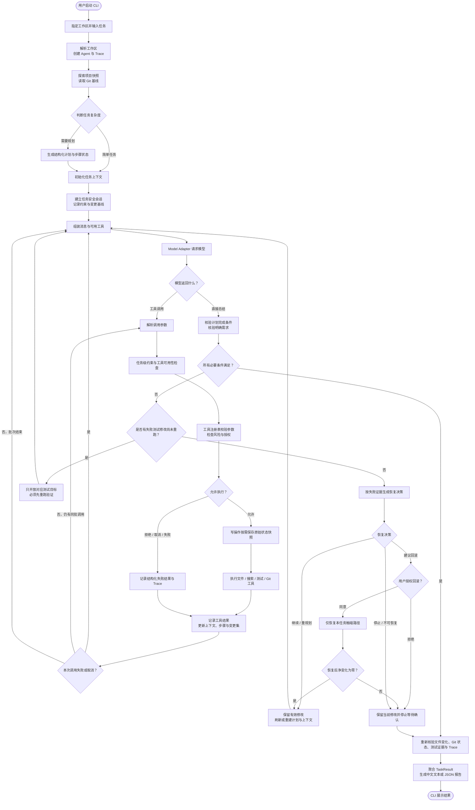

# Mini Coding Agent 项目流程图

本文按当前代码实现整理，分为代码模块协作关系和单次任务工作流程。图中仅展示主要调用与数据流，未实现的长期记忆、评测等远期模块不在图中。

## 1. 文件 / 模块协作关系

此图回答“哪些文件共同完成一项任务”。连线表示主要调用或数据依赖，不代表每个模块之间都存在直接 import。

### 阅读要点

- `app/core/agent.py` 是任务控制枢纽：它组织计划、模型请求、工具调用、状态更新、恢复和最终结果生成。
- 模型只提出下一步动作；实际工具由 `ToolRegistry` 统一校验、按风险授权并执行，工具结果再回到 Agent 上下文。
- 工作区上下文被文件、搜索、测试、Git 和变更快照共同使用，用于统一路径解析与边界控制。
- `ExecutionTrace` 贯穿模型请求、工具调用、测试与完成核验；最终报告由结构化证据聚合，而不是直接采信模型总结。

## 2. 单次任务工作流程

此图回答“用户提交一个任务后，程序按什么顺序运行”。模型可以在一个任务中多轮决定调用工具或结束；控制层负责守住执行约束和完成条件。

### 关键控制点

- **工具边界**：模型调用不会直接执行；参数校验、工作区检查及高风险授权在工具执行路径中落实。
- **测试顺序**：开发计划还没有测试源文件时暂不开放测试工具；失败测试后若代码已有实际修改，先重跑原测试目标，再继续其他操作。
- **完成条件**：计划步骤、工具/测试证据和用户明确要求共同参与判定；模型自然语言总结本身不能证明任务完成。
- **最终报告**：结束前读取真实变更、Git、测试和 Trace 证据，失败或证据不足时以受阻/未完成状态呈现。

## 3. 主要文件速查

| 职责 | 文件 |
|---|---|
| CLI 与交互 | `app/cli/main.py`、`app/cli/report.py` |
| Agent 主循环 | `app/core/agent.py` |
| 规划与上下文 | `app/core/complexity.py`、`app/core/planner.py`、`app/core/context.py`、`app/core/task_state.py` |
| 安全与变更 | `app/core/task_safety.py`、`app/tools/change_snapshot.py`、`app/tools/change_set.py`、`app/tools/rollback.py` |
| 模型、项目与追踪 | `app/runtime/model.py`、`app/runtime/explorer.py`、`app/runtime/workspace.py`、`app/runtime/trace.py` |
| 工具调用 | `app/tools/registry.py`、`app/tools/validation.py`、`app/tools/authorization.py`、`app/tools/tools.py`、`app/tools/git_tools.py` |
| 完成与结果 | `app/core/completion.py`、`app/core/requirements.py`、`app/core/final_verification.py`、`app/core/result_aggregator.py`、`app/core/task_result.py` |
